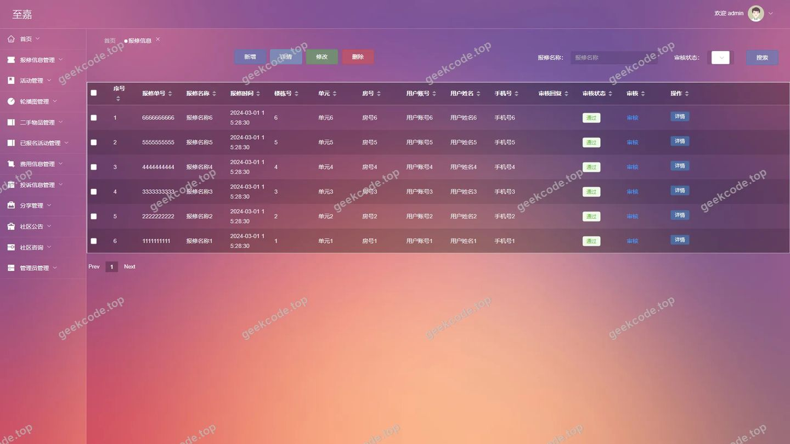
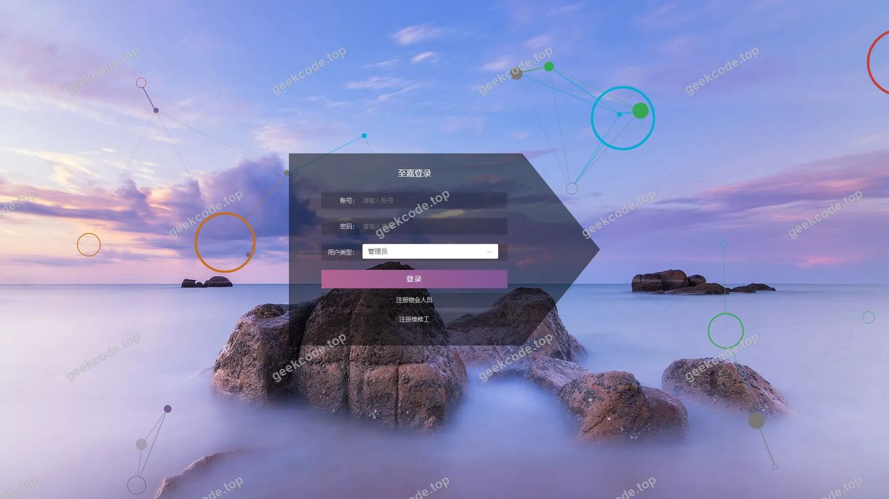
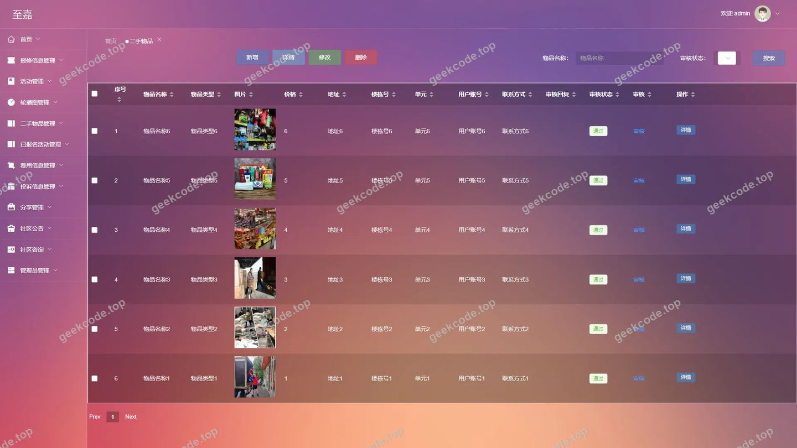
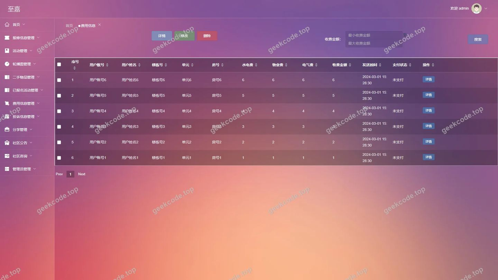
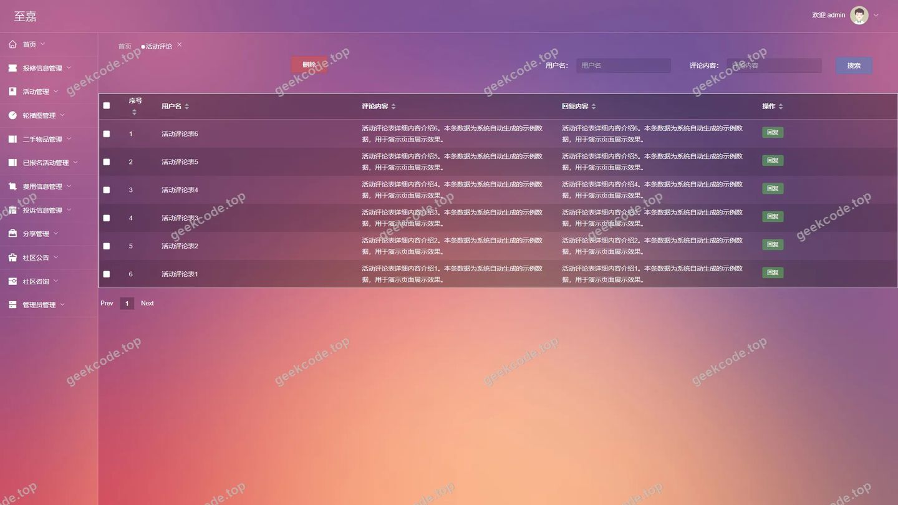
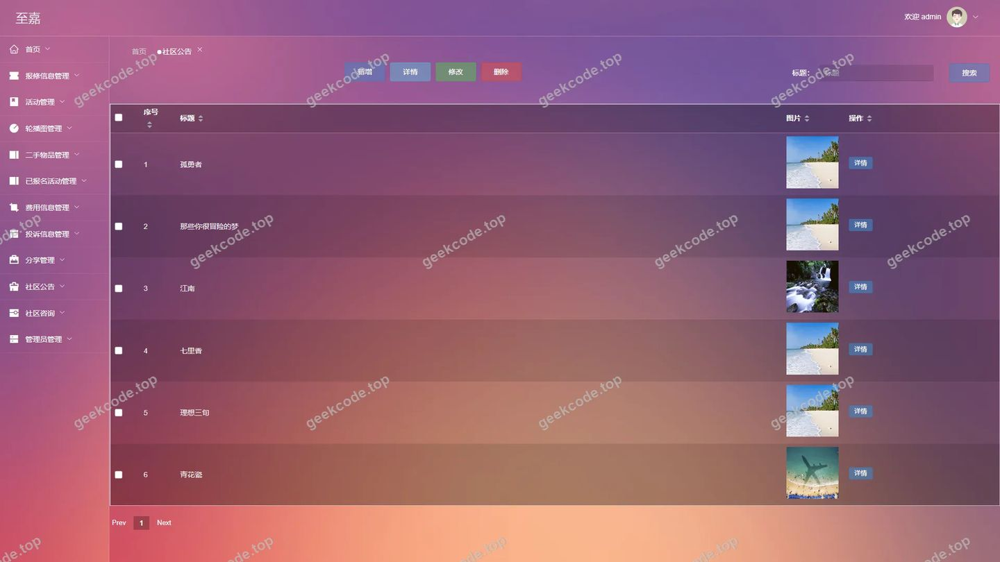
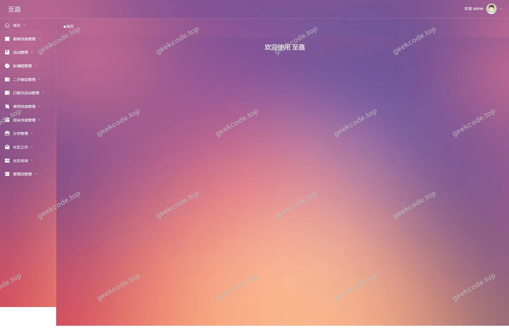
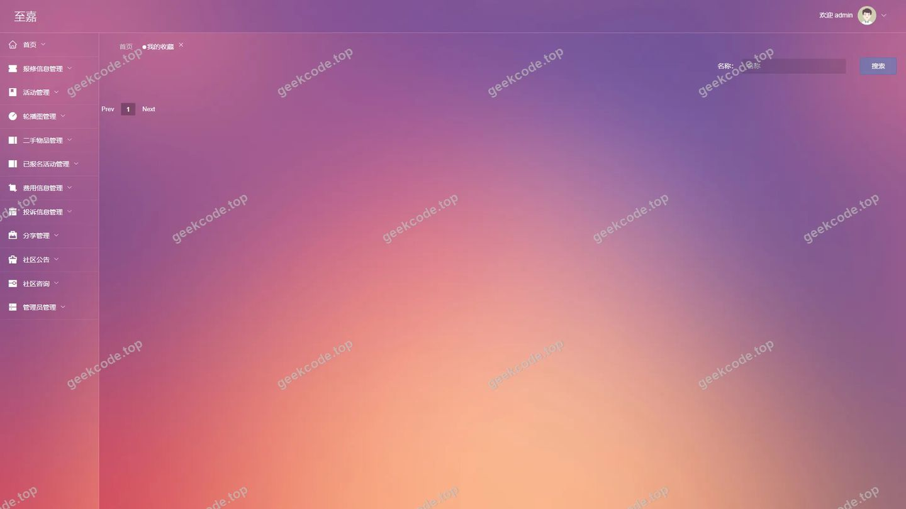

# 基于Android的智慧社区互助平台

> 🎓 **计算机毕业设计 · 基于Android的智慧社区互助平台**
>
> 本仓库只放**项目介绍 + 运行截图**（截图是站点带水印的原图，存在仓库 `images/` 里）。
>
> 👉 **完整可运行源码 / 数据库脚本 / 部署文档：[点我获取](https://geekcode.top/archives/%E5%9F%BA%E4%BA%8EAndroid%E7%9A%84%E6%99%BA%E6%85%A7%E7%A4%BE%E5%8C%BA%E4%BA%92%E5%8A%A9%E5%B9%B3%E5%8F%B0?utm_source=github)**
>
> 💬 咨询微信：**ir9372**　|　🌐 更多项目：[极客代码 geekcode.top](https://geekcode.top/?utm_source=github)
>
> 📌 项目详情页：<https://geekcode.top/archives/%E5%9F%BA%E4%BA%8EAndroid%E7%9A%84%E6%99%BA%E6%85%A7%E7%A4%BE%E5%8C%BA%E4%BA%92%E5%8A%A9%E5%B9%B3%E5%8F%B0?utm_source=github>

<table><td width="230" align="center"> <b>扫码加微信 ir9372</b></td><td valign="middle">📦 源码 = 项目介绍 + 全部运行截图 + 数据库 + 部署文档 👉 点上方任意截图，直接跳到 <b>极客代码 geekcode.top</b> 详情页</td></table>

---

<h1>基于Android的智慧社区互助平台</h1>
<h2>项目概述</h2>

本项目旨在构建一个基于 Android 端交互的智慧社区互助平台后端管理系统，核心目标是通过数字化手段提升社区服务效率与居民生活质量。系统主要服务于社区管理员、物业人员及维修工等角色，提供报修管理、费用公示、二手物品交易、活动组织及投诉处理等功能。技术架构采用 Spring Boot 作为核心框架，结合 MyBatis-Plus 进行数据持久化操作，并引入 Apache Shiro 实现安全认证与权限控制。该方案适用于智慧社区场景下的后台统一管理需求，能够有效整合社区资源，规范服务流程，为前端移动应用提供稳定、安全的 API 支持接口。

<h2>技术架构</h2>
<h3>后端架构</h3>

项目采用典型的 MVC 分层架构设计：

<ul>
<li><strong>表现层</strong>：基于 <code>spring-boot-starter-web</code> 构建 RESTful API 接口，负责接收前端请求并返回 JSON 格式数据。</li>
<li><strong>业务逻辑层</strong>：使用 Spring Boot 原生依赖注入机制管理 Bean，处理核心业务逻辑如用户注册、信息审核等。</li>
<li><strong>数据访问层</strong>：集成 <code>mybatis-spring-boot-starter</code> 和 <code>mybatis-plus</code>，利用 MyBatis-Plus 的通用 Mapper 特性简化 CRUD 操作，提高开发效率。数据库连接池由 <code>spring-boot-starter-jdbc</code> 提供基础支持。</li>
<li><strong>安全框架</strong>：引入 <code>shiro-spring</code> 进行身份认证和授权管理，确保只有具备相应权限的用户才能访问特定模块（如 <code>/users</code>, <code>/config</code> 等）。</li>
</ul>
<h3>数据库设计要点</h3>
<ul>
<li><strong>关系型存储</strong>：使用 MySQL 作为主数据库，通过 <code>mysql-connector-java</code> 驱动进行连接。</li>
<li><strong>实体映射</strong>：利用 MyBatis-Plus 注解实现 Java 对象与数据库表的自动映射，减少 XML 配置文件的维护成本。</li>
<li><strong>数据一致性</strong>：通过事务管理机制保证关键操作（如支付状态更新、库存变更）的数据完整性。</li>
</ul>
<h3>核心技术选型理由</h3>
<ul>
<li><strong>Spring Boot</strong>：具备“约定优于配置”的特性，快速搭建微服务或单体应用骨架，生态丰富且社区活跃。</li>
<li><strong>MyBatis-Plus</strong>：在保留 MyBatis 灵活性的基础上，提供了强大的代码生成器和条件构造器，显著降低样板代码量。</li>
<li><strong>Apache Shiro</strong>：相比 Spring Security 更轻量级，适合中小型项目，易于理解和使用，能有效保护敏感路由（如后台管理入口）。</li>
</ul>
<h2>功能模块</h2>

根据后台路由及截图分析，系统主要包含以下功能模块：

<h3>后台管理端</h3>
<ol>
<li>
<strong>用户管理中心</strong>

<ul>
<li><strong>物业人员管理 (<code>/wuyerenyuanCenter</code>, <code>/wuyerenyuan</code>)</strong>：负责物业人员的账号创建、信息编辑及权限分配。</li>
<li><strong>维修工管理 (<code>/weixiugongCenter</code>, <code>/weixiugong</code>)</strong>：管理维修工基本信息，包括技能标签、工作状态等。</li>
<li><strong>普通用户管理 (<code>/yonghu</code>)</strong>：查看注册用户列表，处理账号冻结或删除请求。</li>
<li><strong>注册管理 (<code>/wuyerenyuanRegister</code>, <code>/weixiugongRegister</code>)</strong>：处理新用户的注册申请审核。</li>
</ul>
</li>
<li>
<strong>社区服务管理</strong>

<ul>
<li><strong>报修信息管理 (<code>/baoxiuxinxi</code>)</strong>：接收并处理居民提交的房屋设施损坏报告，指派维修工，跟踪维修进度。</li>
<li><strong>费用信息管理 (<code>/feiyongxinxi</code>)</strong>：发布物业费、水电费等缴纳通知，记录缴费状态。</li>
<li><strong>投诉信息管理 (<code>/tousuxinxi</code>)</strong>：收集居民对物业服务或社区环境的投诉，并进行回复和处理归档。</li>
</ul>
</li>
<li>
<strong>内容与互动管理</strong>

<ul>
<li><strong>社区公告 (<code>/news</code>)</strong>：发布紧急通知、政策解读等官方资讯。</li>
<li><strong>活动管理 (<code>/huodong</code>, <code>/yibaominghuodong</code>)</strong>：创建社区线下活动，管理报名名单及活动详情。</li>
<li><strong>二手物品管理 (<code>/ershouwupin</code>)</strong>：审核居民发布的闲置物品交易信息，维持交易秩序。</li>
<li><strong>分享与评论管理 (<code>/fenxiang</code>, <code>/discussfenxiang</code>, <code>/discusshuodong</code>)</strong>：管理用户在社区内的动态分享及针对活动、分享的评论互动内容。</li>
</ul>
</li>
<li>
<strong>系统与基础配置</strong>

<ul>
<li><strong>我的收藏 (<code>/storeup</code>)</strong>：查看用户收藏的资源列表（后台视角）。</li>
<li><strong>消息中心 (<code>/messages</code>)</strong>：管理系统内部通知及用户留言。</li>
<li><strong>系统配置 (<code>/config</code>)</strong>：设置平台全局参数，如轮播图、站点名称等。</li>
<li><strong>管理员登录 (<code>/login</code>)</strong>：超级管理员的身份验证入口。</li>
</ul>
</li>
</ol>

<em>注：根据现有信息无法确定是否存在独立的前台用户界面，所有描述均基于后台路由及 admin 截图推导。</em>

<h2>用户角色与权限</h2>

系统主要划分为两类角色，具体权限如下：

<h3>1. 超级管理员 (Admin)</h3>
<ul>
<li><strong>访问范围</strong>：拥有最高权限，可访问所有后台路由。</li>
<li><strong>具体功能</strong>：<ul>
<li><strong>全量数据管理</strong>：增删改查物业人员、维修工、普通用户的所有账户信息。</li>
<li><strong>业务流程审批</strong>：审核报修单、投诉单、二手物品发布申请、活动报名资格。</li>
<li><strong>内容发布与维护</strong>：发布公告、创建社区活动、管理评论与分享内容。</li>
<li><strong>系统配置</strong>：修改系统基础参数，查看全站统计数据（首页看板）。</li>
<li><strong>安全管控</strong>：重置用户密码，禁用违规账号，查看操作日志。</li>
</ul>
</li>
</ul>
<h3>2. 业务操作员 (隐含角色，基于路由推断)</h3>

<em>说明：虽然路由未明确区分子角色，但通常此类系统中物业人员和维修工可能拥有受限的后台视图。但在当前提供的 Admin 截图中，仅展示了统一的管理员视角。若存在细分角色，其权限应严格限制在其所属领域：</em>

<ul>
<li><strong>物业人员</strong>：仅能查看和管理与其辖区相关的报修、投诉及费用信息；管理本小区的活动报名。</li>
<li><strong>维修工</strong>：仅能查看指派给个人的报修任务，更新维修状态；查看相关费用结算信息。</li>
</ul>

<em>(依据现有上下文，主要可见角色为 Admin，其他角色权限需结合具体前端交互确认，此处不做过度推测)</em>

<h2>项目特色与创新点</h2>
<ol>
<li><strong>全流程闭环管理</strong>：从居民发起报修到维修工接单、完工反馈，再到费用结算，实现了社区服务业务的数字化闭环，减少了传统纸质记录的丢失风险。</li>
<li><strong>多维度的社区互动体系</strong>：不仅限于单向的通知发布，还引入了“二手物品”、“活动分享”、“评论讨论”等社交属性模块，增强了邻里间的联系与互助氛围。</li>
<li><strong>细粒度的角色隔离</strong>：通过 Shiro 框架将物业人员、维修工与普通用户的数据视图进行逻辑隔离，确保了隐私安全（如普通用户无法看到其他住户的详细投诉内容）。</li>
<li><strong>高效的技术栈组合</strong>：采用 MyBatis-Plus 大幅提升了后台管理系统的开发速度，使得复杂的多表关联查询（如活动-报名-评论）得以快速实现和维护。</li>
</ol>
<h2>部署环境</h2>

为确保项目正常运行，需要以下软件环境支持：

<table>
<thead>
<tr>
<th align="left">组件</th>
<th align="left">版本要求/推荐</th>
<th align="left">说明</th>
</tr>
</thead>
<tbody><tr>
<td align="left"><strong>JDK</strong></td>
<td align="left">JDK 1.8 及以上</td>
<td align="left">Spring Boot 运行基础环境</td>
</tr>
<tr>
<td align="left"><strong>Maven</strong></td>
<td align="left">3.6+</td>
<td align="left">项目依赖管理与构建工具</td>
</tr>
<tr>
<td align="left"><strong>MySQL</strong></td>
<td align="left">5.7 或 8.0</td>
<td align="left">数据存储引擎，需安装 mysql-connector-java 对应驱动</td>
</tr>
<tr>
<td align="left"><strong>IDE</strong></td>
<td align="left">IntelliJ IDEA / Eclipse</td>
<td align="left">代码开发与调试环境</td>
</tr>
<tr>
<td align="left"><strong>Node.js</strong></td>
<td align="left">LTS 版本</td>
<td align="left">若涉及前端静态资源编译（虽为 vue-integrated，后端部署通常只需 jar 包，但若需重新编译前端则需 Node）</td>
</tr>
<tr>
<td align="left"><strong>Android Studio</strong></td>
<td align="left">最新版</td>
<td align="left">用于测试与之配套的 Android 客户端应用</td>
</tr>
</tbody></table>

<strong>启动步骤简述：</strong>

<ol>
<li>导入 SQL 脚本初始化 MySQL 数据库。</li>
<li>修改 <code>application.yml</code> 中的数据库连接地址、用户名和密码。</li>
<li>使用 Maven 命令 <code>mvn clean package</code> 打包项目。</li>
<li>执行 <code>java -jar target/*.jar</code> 启动服务。</li>
</ol>
<h2>五、技术特性</h2>
<ul>
<li>前后端集成部署，前端资源打包至后端 static 目录</li>
<li>使用 MyBatis-Plus 简化数据访问层开发</li>
<li>集成 Shiro 权限框架实现角色权限控制</li>
</ul>
<h2>六、功能模块截图</h2>
<h3>后台管理端</h3>
<h4>后台-报修信息</h4>

<h4>后台-登录页</h4>

<h4>后台-二手物品</h4>

<h4>后台-费用信息</h4>

<h4>后台-活动评论</h4>

<h4>后台-社区公告</h4>

<h4>后台首页</h4>

<h4>后台-我的收藏</h4>

---

## 获取完整源码

| 项目 | 说明 |
| --- | --- |
| 项目名 | 基于Android的智慧社区互助平台 |
| 运行截图 | 本文 8 张（站点带水印原图，仓库 `images/` 目录） |
| 完整源码 | [https://geekcode.top/archives/%E5%9F%BA%E4%BA%8EAndroid%E7%9A%84%E6%99%BA%E6%85%A7%E7%A4%BE%E5%8C%BA%E4%BA%92%E5%8A%A9%E5%B9%B3%E5%8F%B0?utm_source=github](https://geekcode.top/archives/%E5%9F%BA%E4%BA%8EAndroid%E7%9A%84%E6%99%BA%E6%85%A7%E7%A4%BE%E5%8C%BA%E4%BA%92%E5%8A%A9%E5%B9%B3%E5%8F%B0?utm_source=github) |
| 咨询微信 | **ir9372**（备注：jingpin-yuanma） |
| 更多项目 | [极客代码 geekcode.top](https://geekcode.top/?utm_source=github) |

> 需要源码、部署、改配置、跑不起来等问题，加微信 ir9372 沟通，说明项目名即可。
